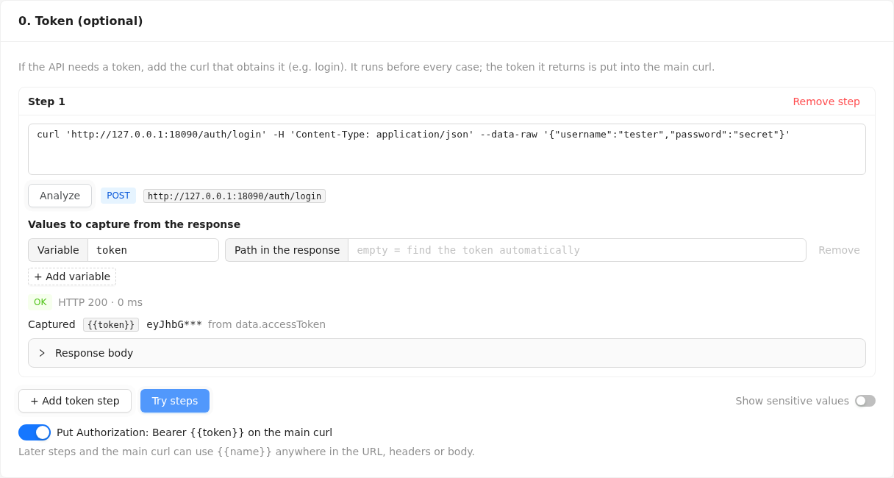

# API Case Runner user guide

API Case Runner lets a tester take one API request as a `curl` command and run it with many data sets, without writing code. This guide covers what the current version does: **get a token when the API needs one, paste a curl, check the request, and set a rule for every field of its JSON body**. Entering test cases, running them and exporting reports come in the next releases ([BRD-001 §18](brd/BRD-001.md#18-implementation-plan-small-steps)).

Vietnamese version: [user-guide.vi.md](user-guide.vi.md).

## 1. Start API Case Runner

API Case Runner is one program that serves both the web page and its API.

```sh
cd caserunner
scripts/build.sh          # once, or after pulling new code
backend/bin/caserunner
```

Then open **http://127.0.0.1:8080** in a browser. The tag at the top right shows **BE OK** and the version when the tool is ready. The **VI / EN** switch next to it changes the language of the page; your choice is remembered.

| Want to | Do |
|---|---|
| Keep it running after closing the terminal | `nohup backend/bin/caserunner > caserunner.log 2>&1 &` and stop it later with `kill <pid>` |
| Use another port, or let teammates open it | `CASERUNNER_BIND=0.0.0.0:9090 backend/bin/caserunner` (by default only your own machine can reach it) |
| Stop it | `Ctrl+C` in its terminal |

Building needs Go 1.27+ and Node.js 20.19+; if a developer hands you a ready-built `caserunner` binary, just run it.

## 2. Copy the request as curl

| From | How |
|---|---|
| Chrome / Edge DevTools | Network tab → right-click the request → **Copy** → **Copy as cURL (bash)** or **Copy as cURL (cmd)** |
| Firefox DevTools | Network tab → right-click the request → **Copy Value** → **Copy as cURL** |
| Postman | Open the request → **Code** (`</>`) → **cURL** → copy |

Both the bash and the Windows cmd style work; you do not need to clean the text up.

## 3. Paste and analyze

Paste the command into **1. Curl** and click **Analyze** (or press **Ctrl+Enter**).


## 4. Check the request

**2. Request** shows what API Case Runner understood:

- **Request**: the method and the URL (the copy icon copies the URL).
- **Body**: `JSON`, `No body`, or `Unsupported`.
- **Warnings**: things the tool ignored or changed, such as *"Ignored --compressed"*. Read them; they never stop you, but they explain any difference from running the curl yourself.
- **Headers**: every header in order. Values of `Authorization`, `Cookie`, `X-Api-Key` and headers containing `token` or `secret` are masked (first 6 characters + `***`). Turn on **Show sensitive values** to see them in full.


## 5. Set the field rules

**3. Field rules** lists every field of the JSON body, in the body's order:

| Column | Meaning |
|---|---|
| **Field path** | Where the field sits: `data.account.id` is `id` inside `account` inside `data`; `items[0].sku` is `sku` in the first item of the `items` array. A key that contains a dot or a bracket is written in quotes, e.g. `["key.with.dot"]`. |
| **Type** | `string`, `number`, `boolean`, `null`, or `object` / `array` for an empty `{}` / `[]`. |
| **Sample value** | The value in your curl, written the way you would type it in a test case: `<EMPTY>` is an empty string `""`, `<NULL>` is `null`. Numbers keep every digit, e.g. a 20-digit account number. |
| **Rule** | **Required** (default) or **Unrequired**. |

What the rule will mean when you run cases:

- **Required**: every case must give this field a value. A case that leaves it empty is **BLOCKED** and never sent.
- **Unrequired**: a case may leave it empty, and then the field is **left out of the request entirely**. Use this to test how the API handles a missing field.

**All Required** and **All Unrequired** set every rule at once; the counter above the table shows how many of each you have. If you edit the curl and analyze again, fields that still exist keep the rule you chose.

## 6. Get a token first (optional)

Most APIs outside a developer's laptop need a token, usually from a login API. Instead of copying a token by hand (and again when it expires), let the tool fetch it:

1. In **0. Token (optional)**, click **Add token step** and paste the curl of the login (or token) API, copied the same way as in section 2. Click **Analyze**.
2. Under **Values to capture from the response**, the first variable is already named `token` with an empty **Path**: the tool then finds the token by itself, looking for a field named `access_token`, `accessToken`, `token`, `id_token`, `jwt`, … at any depth. If your API puts it elsewhere, type the path, e.g. `data.auth.value`.
3. Click **Try steps**. Each step shows **OK** or why it failed, the HTTP code, the value it captured (masked; turn on **Show sensitive values** to see it) and where it was found, e.g. *from data.accessToken*. Open **Response body** to see the full answer.
4. Keep **Put Authorization: Bearer {{token}} on the main curl** on: when cases run, the main curl gets a fresh `Authorization: Bearer <token>`, replacing the one you pasted. In **2. Request** the old `Authorization` row is struck through to show it.



When cases run, the token steps run again **before every case**, so every case gets a new token and cases run one after another. *(Running cases arrives with the next release; for now **Try steps** lets you check that the token is obtained.)*

**Multi-step flows** (login → OTP → …): add more steps. A later step can use what an earlier one captured by writing `{{name}}` anywhere in its URL, headers or body, e.g. `-H 'Authorization: Bearer {{token}}'` or `"session":"{{sessionId}}"`. The main curl can use `{{name}}` the same way; **2. Request** lists the variables it uses and flags one that no step captures.

| Step result | What to do |
|---|---|
| *Expected a 2xx response, got HTTP 401* | The login itself was refused: check the account in the step's curl. |
| *token: no token field found in the response* | The token has another name: open **Response body**, find it, and type its path. |
| *token: no value at data.x* | The path is wrong; check it against **Response body**. |
| *Host … is not in CASERUNNER_ALLOWED_HOSTS* | The tool is set to reach only some hosts; ask whoever runs it to add this one. |
| *Unknown variable {{x}}* | No earlier step captures `x`; add the capture or fix the name. |

## 7. When the curl cannot be used

The message under the curl explains what to fix. The position counts characters from the start of the text.


| Message (start) | What to do |
|---|---|
| *Missing closing ' for the quote opened at position N* | The copy was cut off or a quote is missing; copy the request again. |
| *A curl command must start with curl* | Paste only the command, starting at `curl`. |
| *No URL found* / *Found a second URL* | Keep exactly one URL in the command. |
| *-d @file reads the body from a file* | Replace `@file` with the body itself. |
| *-G is not supported* / *-T is not supported* | These change the request in ways API Case Runner cannot reproduce; remove them and put the data in the body. |
| *Only http and https URLs are supported* | Use an `http://` or `https://` URL. |
| *The JSON body cannot be split into fields: duplicate key* | The body repeats a key in one object; remove the duplicate. |

A request with a form or file-upload body (`-F`, `--data-urlencode`) or a non-JSON body is analyzed, but shows **v1 supports JSON bodies only** and cannot be run:


Common warnings that need no action:

| Warning | Meaning |
|---|---|
| *Ignored --compressed*, *Ignored -s*, … | Output and transport options; they do not change the request. |
| *Ignored -L: redirects are never followed* | A redirect (3xx) will be reported as the result instead of being followed. |
| *Ignored --max-time: the run's timeout applies* | Timeouts are set per run in API Case Runner. |
| *No Content-Type header* | The API may not read the body as JSON; add `-H 'Content-Type: application/json'` if it should. |
| *The URL has no scheme; using http://…* | Add `https://` if the API needs it. |

## 8. Good to know

- API Case Runner keeps nothing on disk. Closing or reloading the page loses what you entered.
- Your curl, including tokens, is sent only to your own API Case Runner server and is never written to its log.
- **Try steps** sends real requests. Use API Case Runner against LOCAL, DEV or UAT environments, never production. Whoever runs the tool can restrict the hosts it may call with `CASERUNNER_ALLOWED_HOSTS`, e.g. `CASERUNNER_ALLOWED_HOSTS='localhost,*.uat.example.com'` ([BRD-001 §13](brd/BRD-001.md#13-safety--security)).

## 9. Troubleshooting

| Symptom | Fix |
|---|---|
| Red **BE down** tag and *Backend unreachable* banner | The API Case Runner program is not running or was stopped; start it again and reload the page. |
| `scripts/build.sh` stops with *the Windows Node.js is on PATH* or *node was not found*, or prints `UNC paths are not supported` | Under WSL the build needs Node.js installed inside Linux, not the Windows one: install it with nvm (`nvm install 22`) as the script explains, open a new terminal, and build again. |
| The page says *The frontend is not built into this binary* | The program was built without the web page; build it with `scripts/build.sh`. |
| `address already in use` when starting | Another program uses port 8080; start with `CASERUNNER_BIND=127.0.0.1:9090` and open that port. |
| The service stops right away with a message naming a `CASERUNNER_` variable | That environment variable has an invalid value; fix or unset it ([BRD-001 §20](brd/BRD-001.md#20-configuration-env)). |
