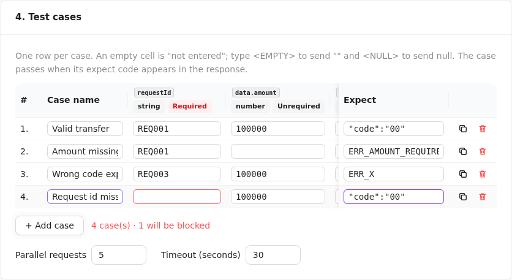
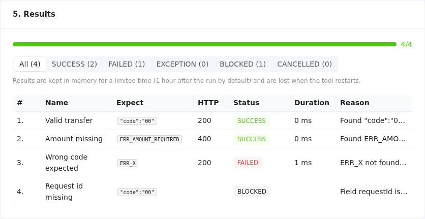

# API Case Runner user guide

API Case Runner lets a tester take one API request as a `curl` command and run it with many data sets, without writing code. This guide covers what the current version does: **get a token when the API needs one, paste a curl, check the request, set a rule for every field of its JSON body, enter test cases, run them and read the results**. Exporting reports comes in a next release ([BRD-001 §18](brd/BRD-001.md#18-implementation-plan-small-steps)).

Vietnamese version: [user-guide.vi.md](user-guide.vi.md).

## 1. Start API Case Runner

API Case Runner is **one program** that serves both the web page and its API; there is no separate frontend or backend to start.

**First time (or after pulling new code): build and start in one command.** In the `caserunner` folder of the repository:

| Windows (PowerShell) | Linux / macOS / WSL |
|---|---|
| `powershell -ExecutionPolicy Bypass -File .\scripts\build.ps1 -Run` | `scripts/build.sh --run` |

The window shows the steps as they happen:

```text
==> frontend                      the web page is built (the first time also downloads its packages)
==> embed                         the page is put inside the program
==> backend                       the program file is compiled
Built …/backend/bin/caserunner    the file you can run directly next time
==> run (Ctrl+C to stop)          the tool is starting
… caserunner listening url=http://127.0.0.1:8080
```

If API Case Runner is already running, the script first stops it (`==> stopping the running API Case Runner (PID …)`) and then starts the new build, so you never need to stop it yourself before rebuilding. It never stops another program: if something else uses the port, it says which program and stops.

When `listening` appears, open **http://127.0.0.1:8080** in a browser. Leave the window open while you use the tool; **Ctrl+C** in it stops the tool. If the script stops at the start with an `error:` line, it names what is missing (Go or Node.js) and prints the command that installs it.

**Next times: just run the built file**; it starts in a second and needs neither Go nor Node.js:

| Windows (PowerShell) | Linux / macOS / WSL |
|---|---|
| `.\backend\bin\caserunner.exe`, or double-click the file | `backend/bin/caserunner` |

If a developer hands you a ready-built program (`caserunner.exe` on Windows), you only need this last step.

The page has a dark top bar and one centered column:

- **Top bar**: the **Run** button (it becomes **Cancel run** while a run is in progress, and **Run again** afterwards), a count of each result status, the **BE OK** tag with the version when the tool is ready, the **🚀 Quick Start** button that opens a short visual walkthrough of the four main steps (useful the first time you open the tool), and the **VI / EN** switch, which changes the language and is remembered.
- **Configuration**: the steps that describe the request, **0. Token**, **1. Curl**, **2. Request** and **3. Field rules**. Click a title to open or close it; a closed step shows a one-line summary on the right, such as *POST https://…* or *5 fields · 4 Required*. **Import config** and **Export config** are at the top of this card.
- **4. Test cases**: a short summary; the case table opens in a popup.
- **5. Results**: filled in live while a run is in progress.

The case popup opens by itself after you analyze a JSON curl; after **Run** it closes and the page scrolls to the results.


| Want to | Windows (PowerShell) | Linux / macOS / WSL |
|---|---|---|
| Stop it | `Ctrl+C` in its window, or close the window | `Ctrl+C` in its terminal |
| Keep it running in the background | `Start-Process -WindowStyle Hidden .\backend\bin\caserunner.exe`, stop with `Stop-Process -Name caserunner` | `nohup backend/bin/caserunner > caserunner.log 2>&1 &`, stop with `kill <pid>` |
| Use another port, or let teammates open it (by default only your own machine can reach it) | `$env:CASERUNNER_BIND = '0.0.0.0:9090'; .\backend\bin\caserunner.exe` | `CASERUNNER_BIND=0.0.0.0:9090 backend/bin/caserunner` |

Building needs Go 1.27+ and Node.js 20.19+ (see the [README](../README.md#quick-start) for installing them).

## 2. Copy the request as curl

| From | How |
|---|---|
| Chrome / Edge DevTools | Network tab → right-click the request → **Copy** → **Copy as cURL (bash)** or **Copy as cURL (cmd)** |
| Firefox DevTools | Network tab → right-click the request → **Copy Value** → **Copy as cURL** |
| Postman | Open the request → **Code** (`</>`) → **cURL** → copy |

Both the bash and the Windows cmd style work; you do not need to clean the text up.

## 3. Paste and analyze

Paste the command into **1. Curl** and click **Analyze** (or press **Ctrl+Enter**).


## 4. Check the request

**2. Request** shows what API Case Runner understood:

- **Request**: the method and the URL (the copy icon copies the URL).
- **Body**: `JSON`, `No body`, or `Unsupported`.
- **Warnings**: things the tool ignored or changed, such as *"Ignored --compressed"*. Read them; they never stop you, but they explain any difference from running the curl yourself.
- **Headers**: every header in order. Values of `Authorization`, `Cookie`, `X-Api-Key` and headers containing `token` or `secret` are masked (first 6 characters + `***`). Turn on **Show sensitive values** to see them in full.


## 5. Set the field rules

**3. Field rules** lists every field of the JSON body, in the body's order:

| Column | Meaning |
|---|---|
| **Field path** | Where the field sits: `data.account.id` is `id` inside `account` inside `data`; `items[0].sku` is `sku` in the first item of the `items` array. A key that contains a dot or a bracket is written in quotes, e.g. `["key.with.dot"]`. |
| **Type** | `string`, `number`, `boolean`, `null`, or `object` / `array` for an empty `{}` / `[]`. |
| **Sample value** | The value in your curl, written the way you would type it in a test case: `<EMPTY>` is an empty string `""`, `<NULL>` is `null`. Numbers keep every digit, e.g. a 20-digit account number. |
| **Rule** | **Required** (default) or **Unrequired**. |

What the rule will mean when you run cases:

- **Required**: every case must give this field a value. A case that leaves it empty is **BLOCKED** and never sent.
- **Unrequired**: a case may leave it empty, and then the field is **left out of the request entirely**. Use this to test how the API handles a missing field.

**All Required** and **All Unrequired** set every rule at once; the counter above the table shows how many of each you have. If you edit the curl and analyze again, fields that still exist keep the rule you chose.

## 6. Get a token first (optional)

Most APIs outside a developer's laptop need a token, usually from a login API. Instead of copying a token by hand (and again when it expires), let the tool fetch it:

1. In **0. Token (optional)**, click **Add token step** and paste the curl of the login (or token) API, copied the same way as in section 2. Click **Analyze**.
2. Under **Values to capture from the response**, the first variable is already named `token` with an empty **Take from field**: the tool then finds the token by itself, looking for a field named `access_token`, `accessToken`, `token`, `id_token`, `jwt`, … at any depth. If your API puts it elsewhere, type the path of that field, each level separated by a dot: for a response `{"data":{"auth":{"value":"eyJ…"}}}` write `data.auth.value`; inside an array add the position, e.g. `data.items[0].id`.
3. Click **Try steps**. Each step shows **OK** or why it failed, the HTTP code, the value it captured (masked; turn on **Show sensitive values** to see it) and where it was found, e.g. *from data.accessToken*. Open **Response body** to see the full answer.
4. Keep **Put Authorization: Bearer {{token}} on the main curl** on: when cases run, the main curl gets a fresh `Authorization: Bearer <token>`, replacing the one you pasted. In **2. Request** the old `Authorization` row is struck through to show it.


When cases run, the token steps run again **before every case**, so every case gets a new token and cases run one after another. **Try steps** lets you check that the token is obtained before you run.

**Multi-step flows** (login → OTP → …): add more steps. A later step can use what an earlier one captured by writing `{{name}}` anywhere in its URL, headers or body, e.g. `-H 'Authorization: Bearer {{token}}'` or `"session":"{{sessionId}}"`. The main curl can use `{{name}}` the same way; **2. Request** lists the variables it uses and flags one that no step captures.

| Step result | What to do |
|---|---|
| *Expected a 2xx response, got HTTP 401* | The login itself was refused: check the account in the step's curl. |
| *token: no token field found in the response* | The token has another name: open **Response body**, find it, and type its path. |
| *token: no value at data.x* | The path is wrong; check it against **Response body**. |
| *Host … is not in CASERUNNER_ALLOWED_HOSTS* | The tool is set to reach only some hosts; ask whoever runs it to add this one. |
| *Unknown variable {{x}}* | No earlier step captures `x`; add the capture or fix the name. |

## 7. Write and run test cases

When a JSON curl is analyzed, the case table opens in a large popup. Afterwards **4. Test cases** on the page shows how many cases there are and how many will be blocked, with the run options; **Edit test cases** opens the popup again. The table has one column per field, plus **Case name** and **Expect**. After Analyze it already holds one row filled with the values from your curl. Close the popup with **Close** or **×**, or click **Run** in it to close it and start the run; either way your rows are kept, also after the run. They are reset to one sample row only when you click **Clear cases** (it asks first), or when you analyze a curl for **another API** (another method, or another address without the part after `?`). Analyzing the same API again, with other body values, headers or query, keeps them. Reloading the page loses them.



**Add a case**: click **+ Add case** for an empty row, or **Duplicate** on a row to copy it and change only what differs. **Delete** removes a row. A run takes at most 1,000 cases.

**Fill a cell**:

| You type | The request gets |
|---|---|
| a value, e.g. `100000`, `abc`, `true` | that value, with the field's type: a `number` field gets the number unquoted, a `string` field gets the text in quotes |
| nothing (empty cell) | a **Required** field: the case is **BLOCKED** and not sent; an **Unrequired** field: the field is left out of the request |
| `<EMPTY>` | an empty string `""` |
| `<NULL>` | `null` |
| `{"a":1}` or `[1,2]` in an `object` / `array` field | that JSON |
| `{{token}}` or another `{{name}}` | the value a token step captured (section 6) |

A cell that does not fit its type (`abc` in a `number` field) makes the case BLOCKED with *Field … expects type number, got …*; the case is never sent.

**Expect** is required: it is the code that proves the API answered as you want, for example `"code":"00"`, `ERR_AMOUNT_REQUIRED` or `401`. After the case runs, the tool looks for it in this order:

1. **The HTTP status**, only as the whole code: `401` matches HTTP 401; `00` never matches HTTP 200 or 500.
2. **The response body** (its first 1 MB), as text, case-sensitive.
3. **The response headers**, as `Name: value`, except technical ones such as `Date`, `Content-Length`, `Content-Type` and `Server`, whose values would match short codes by accident.

Found → **SUCCESS**; not found → **FAILED**. The HTTP status alone never decides: an API that answers 200 with `{"code":"99"}` fails a case that expects `"code":"00"`. Prefer a distinctive expect: `00` alone also matches `"amount":1000000`, while `"code":"00"` matches only that field.

An empty Required cell or Expect is outlined in red, with the reason on hover, and the line under the table (and the summary on the page) counts the cases that will be blocked. You can still run: the tool asks you to confirm, then sends the other cases.

**Run options**, on the **4. Test cases** card:

| Option | Meaning |
|---|---|
| **Parallel requests** | How many cases are sent at the same time (1–20, default 5). With token steps it is fixed at 1: cases run one at a time, each after its own token steps. |
| **Timeout (seconds)** | How long to wait for each answer (1–120, default 30). A case that waits longer ends as EXCEPTION. |

Click **Run** in the top bar (or in the popup). **5. Results** fills in as cases finish, without reloading the page:



| Status | Meaning |
|---|---|
| **SUCCESS** | The expect code was found. |
| **FAILED** | The API answered, but the expect code was not in the status, body or headers. |
| **EXCEPTION** | No usable answer: timeout, connection refused, host not allowed, or a token step failed (the case is not sent then). |
| **BLOCKED** | The case was not sent because a Required cell or the expect was empty, or a value did not fit its type. |
| **CANCELLED** | You cancelled the run before this case was sent. |

The progress bar shows finished cases out of the total, and the top bar counts each status; click a status above the table to show only those cases. **Reason** says why, e.g. *Found "code":"00" in the body (HTTP 200)* or *ERR_X not found in the response (HTTP 200)*.

Click a row to see the details: where the code was found, the values sent, the request body exactly as sent and the response body with the expect code highlighted.


**Cancel run** (top bar) stops a run: cases not yet sent become CANCELLED; a case already in flight ends as EXCEPTION. **Run again** (top bar) sends the same cases again with what is on the page now and replaces the results. Every run really sends requests: run against LOCAL, DEV or UAT only, never production, and never retry a payment case blindly.

Results are kept in the tool's memory for 1 hour after the run (by default) and are lost when the tool restarts.

**Save your work**: **Export config** (top of **Configuration**) downloads a `.json` file with the token steps, the curl, the rules, the cases and the run options. Captured token values are never saved, but the curls are saved as you pasted them, including their own `Authorization` headers: keep the file private. **Import config** (next to it) loads such a file back and analyzes the curls again.

## 8. When the curl cannot be used

The message under the curl explains what to fix. The position counts characters from the start of the text.


| Message (start) | What to do |
|---|---|
| *Missing closing ' for the quote opened at position N* | The copy was cut off or a quote is missing; copy the request again. |
| *A curl command must start with curl* | Paste only the command, starting at `curl`. |
| *No URL found* / *Found a second URL* | Keep exactly one URL in the command. |
| *-d @file reads the body from a file* | Replace `@file` with the body itself. |
| *-G is not supported* / *-T is not supported* | These change the request in ways API Case Runner cannot reproduce; remove them and put the data in the body. |
| *Only http and https URLs are supported* | Use an `http://` or `https://` URL. |
| *The JSON body cannot be split into fields: duplicate key* | The body repeats a key in one object; remove the duplicate. |

A request with a form or file-upload body (`-F`, `--data-urlencode`) or a non-JSON body is analyzed, but shows **v1 supports JSON bodies only** and cannot be run:


Common warnings that need no action:

| Warning | Meaning |
|---|---|
| *Ignored --compressed*, *Ignored -s*, … | Output and transport options; they do not change the request. |
| *Ignored -L: redirects are never followed* | A redirect (3xx) will be reported as the result instead of being followed. |
| *Ignored --max-time: the run's timeout applies* | Timeouts are set per run in API Case Runner. |
| *No Content-Type header* | The API may not read the body as JSON; add `-H 'Content-Type: application/json'` if it should. |
| *The URL has no scheme; using http://…* | Add `https://` if the API needs it. |

## 9. Good to know

- API Case Runner keeps nothing on disk. Closing or reloading the page loses what you entered.
- Your curl, including tokens, is sent only to your own API Case Runner server and is never written to its log.
- **Try steps** and **Run** send real requests. Use API Case Runner against LOCAL, DEV or UAT environments, never production. Whoever runs the tool can restrict the hosts it may call with `CASERUNNER_ALLOWED_HOSTS`, e.g. `CASERUNNER_ALLOWED_HOSTS='localhost,*.uat.example.com'` ([BRD-001 §13](brd/BRD-001.md#13-safety--security)).

## 10. Troubleshooting

| Symptom | Fix |
|---|---|
| Red **BE down** tag and *Backend unreachable* banner | The API Case Runner program is not running or was stopped; start it again and reload the page. |
| `scripts/build.sh` stops with *the Windows Node.js is on PATH* or *node was not found*, or prints `UNC paths are not supported` | Under WSL the build needs Node.js installed inside Linux, not the Windows one: install it with nvm (`nvm install 22`) as the script explains, open a new terminal, and build again. |
| The page says *The frontend is not built into this binary* | The program was built without the web page; build it with `scripts/build.sh`. |
| *X case(s) will be blocked* when clicking **Run** | Some rows have an empty Required cell or Expect (outlined in red); fill them, or confirm to run the others. |
| *Inject token needs a capture named token* | **Put Authorization: Bearer {{token}} on the main curl** is on, but no token step captures a variable named `token`; rename the capture to `token`, or turn the option off. |
| A case is BLOCKED with *Unknown variable {{x}}: no token step captures it* | The case or the main curl uses `{{x}}`; add a token step capture named `x`, or fix the name. |
| *Too many runs are in progress* | The tool holds `CASERUNNER_MAX_RUNS` runs (50 by default) and all of them are still running; wait for one to finish or cancel one. |
| *Run has expired, please run it again* | Results are kept 1 hour by default and are lost on restart; click **Run** again. |
| *Lost the connection to the run* | The page could not follow the run (the tool was stopped or the network dropped); check that the tool runs and click **Run** again. |
| `address already in use` (Linux) or *Only one usage of each socket address is normally permitted* (Windows) when starting | Another program uses port 8080, often an API Case Runner that is already running; stop it, or start with another port (`CASERUNNER_BIND=127.0.0.1:9090`) and open that port. |
| *port 8080 is used by … (PID …), not API Case Runner* when building with `--run` / `-Run` | Another program uses the port; stop it, or pick another port with `CASERUNNER_BIND` (see section 1). |
| *API Case Runner is running (PID …), so the build cannot replace caserunner.exe* (Windows) | Build with `-Run` to restart it, or stop it first. |
| The page shows *Host … is not accepted; open the tool at http://127.0.0.1:…* | The tool only answers to `127.0.0.1` or `localhost` (protection against malicious web sites); open the address it gives. To reach it by the machine's name or IP, start it with `CASERUNNER_BIND=0.0.0.0:8080`. |
| PowerShell: *running scripts is disabled on this system* | Run the build as `powershell -ExecutionPolicy Bypass -File .\scripts\build.ps1`. |
| `build.ps1` stops with *Node.js v… is too old* or *was not found on PATH* | Install what it names with the `winget` command it prints, open a new PowerShell window, and build again. |
| The service stops right away with a message naming a `CASERUNNER_` variable | That environment variable has an invalid value; fix or unset it ([BRD-001 §20](brd/BRD-001.md#20-configuration-env)). |
