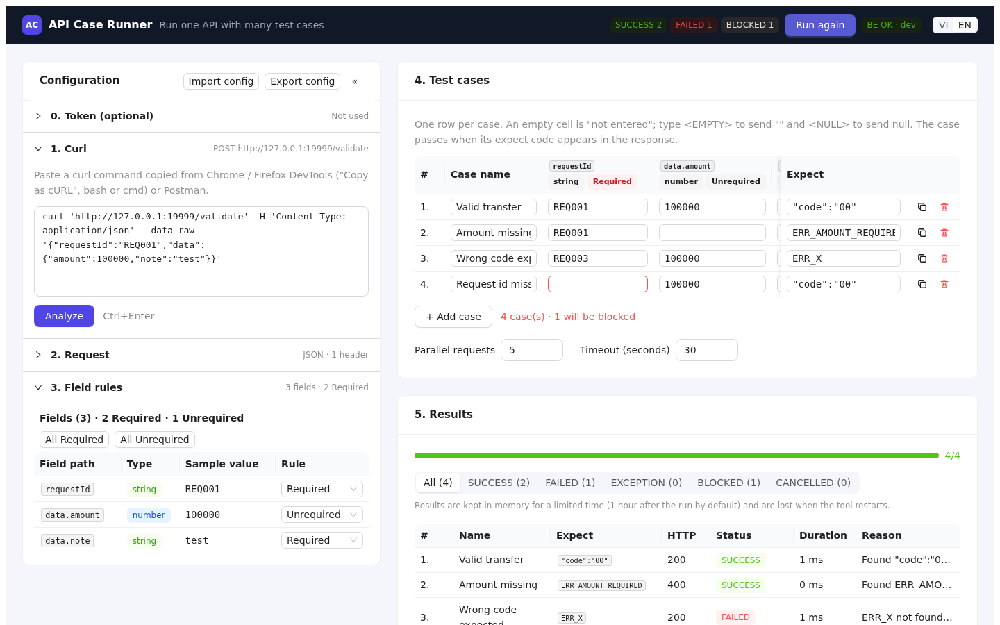
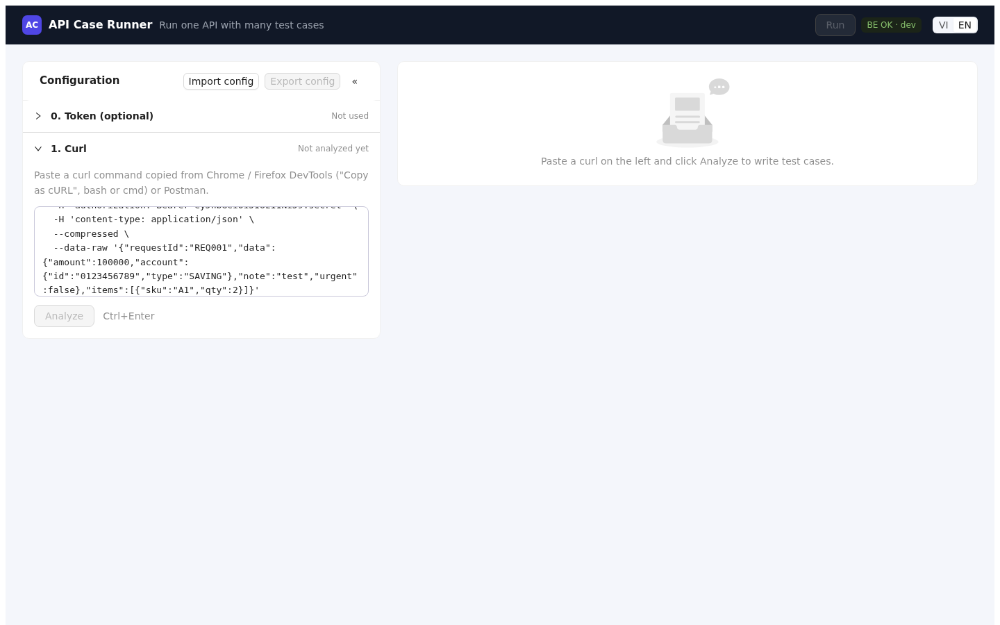
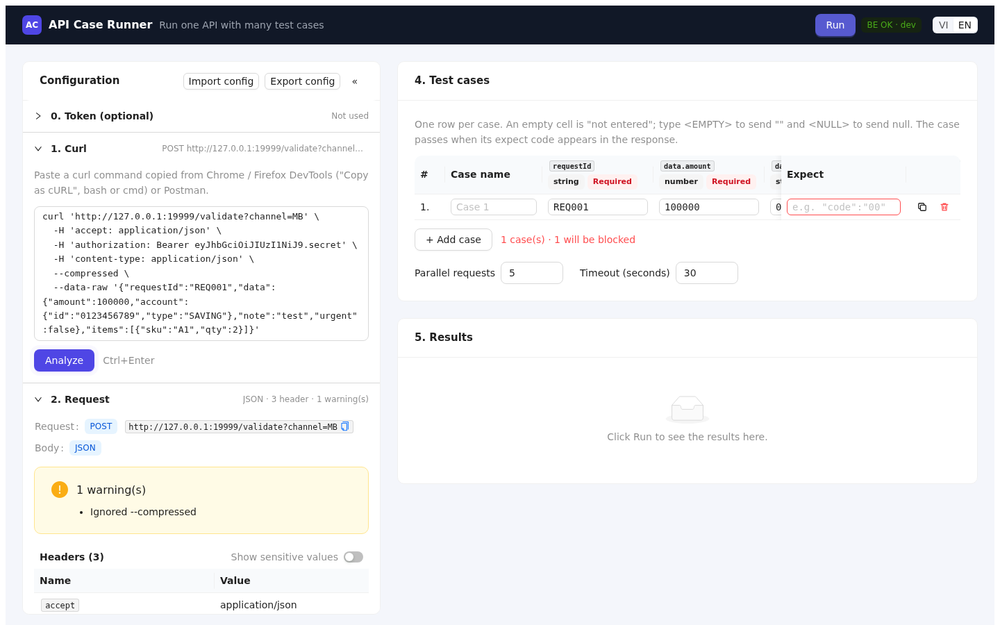
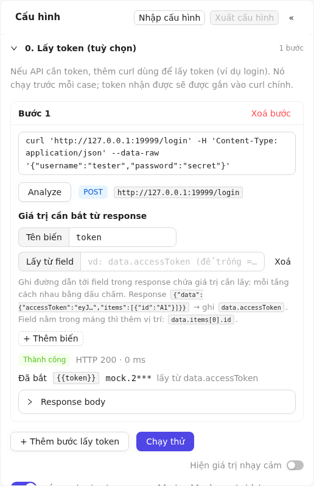
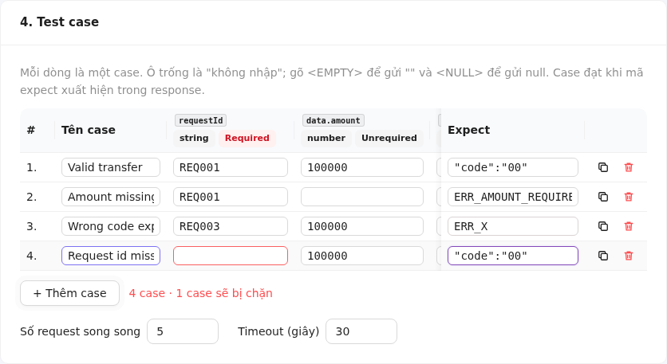
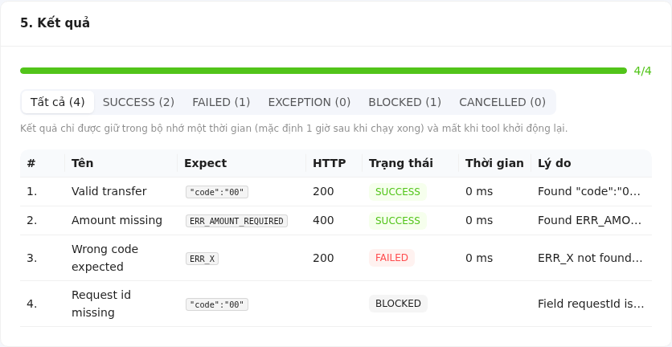
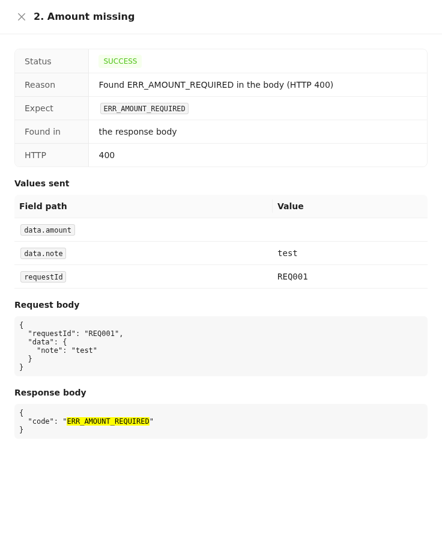
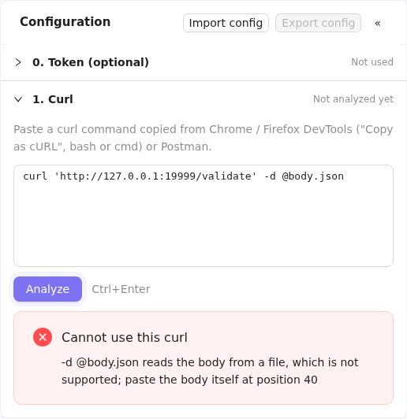
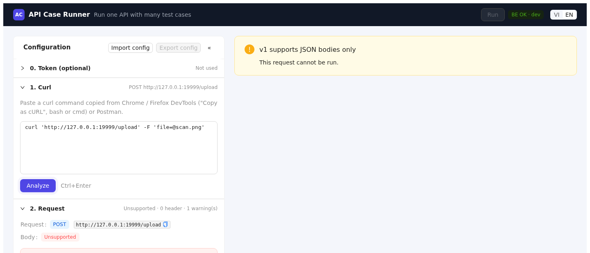

# Hướng dẫn sử dụng API Case Runner

API Case Runner giúp tester lấy một request API dưới dạng lệnh `curl` rồi chạy nó với nhiều bộ dữ liệu, không cần viết code. Hướng dẫn này nói về những gì phiên bản hiện tại làm được: **lấy token khi API cần, dán curl, kiểm tra request, đặt rule cho từng field trong JSON body, nhập test case, chạy và đọc kết quả**. Xuất báo cáo sẽ có ở bản tiếp theo ([BRD-001 §18](brd/BRD-001.vi.md#18-kế-hoạch-implement-từng-step-nhỏ)).

Bản tiếng Anh: [user-guide.md](user-guide.md).

## 1. Khởi động API Case Runner

API Case Runner là **một chương trình duy nhất**, phục vụ cả trang web lẫn API của nó; không phải bật FE và BE riêng.

**Lần đầu (hoặc sau khi kéo code mới về): build và chạy bằng một lệnh.** Trong thư mục `caserunner` của repo:

| Windows (PowerShell) | Linux / macOS / WSL |
|---|---|
| `powershell -ExecutionPolicy Bypass -File .\scripts\build.ps1 -Run` | `scripts/build.sh --run` |

Cửa sổ sẽ hiện lần lượt từng bước:

```text
==> frontend                      build trang web (lần đầu tải thêm các package của nó)
==> embed                         đưa trang web vào trong chương trình
==> backend                       biên dịch ra file chương trình
Built …/backend/bin/caserunner    file này lần sau chạy thẳng được
==> run (Ctrl+C to stop)          tool đang khởi động
… caserunner listening url=http://127.0.0.1:8080
```

Nếu API Case Runner đang chạy sẵn, script sẽ tắt nó trước (`==> stopping the running API Case Runner (PID …)`) rồi mới bật bản vừa build, nên không cần tự tắt trước khi build lại. Script không bao giờ tắt chương trình khác: nếu cổng đang bị chương trình khác dùng, nó báo tên chương trình đó và dừng lại.

Khi thấy dòng `listening`, mở **http://127.0.0.1:8080** trên trình duyệt. Giữ cửa sổ đó mở trong lúc dùng tool; nhấn **Ctrl+C** trong cửa sổ để dừng. Nếu script dừng ngay từ đầu với một dòng `error:`, nó sẽ nêu thứ còn thiếu (Go hoặc Node.js) và in sẵn lệnh để cài.

**Những lần sau: chỉ cần chạy file đã build**; khởi động trong một giây và không cần Go hay Node.js:

| Windows (PowerShell) | Linux / macOS / WSL |
|---|---|
| `.\backend\bin\caserunner.exe`, hoặc nhấp đúp vào file | `backend/bin/caserunner` |

Nếu developer đưa sẵn chương trình đã build (`caserunner.exe` trên Windows) thì bạn chỉ cần bước cuối này.

Trang có một thanh trên màu tối và hai cột:

- **Thanh trên**: nút **Chạy** (thành **Huỷ run** khi đang chạy, và **Chạy lại** sau đó), số case theo từng trạng thái, tag **BE OK** kèm phiên bản khi tool đã sẵn sàng, và nút **VI / EN** để đổi ngôn ngữ (lựa chọn được ghi nhớ).
- **Cột trái, Cấu hình**: các bước mô tả request, **0. Lấy token**, **1. Curl**, **2. Request** và **3. Field rules**. Bấm vào tiêu đề để mở hoặc thu gọn; bước đang thu gọn hiện một dòng tóm tắt bên phải, ví dụ *POST https://…* hay *5 field · 4 Required*. **Nhập cấu hình** và **Xuất cấu hình** nằm ở đầu cột này. Nút **«** thu cột thành một dải hẹp để bảng case và kết quả dùng hết bề ngang; bấm vào dải đó để mở lại.
- **Cột phải**: **4. Test case** và bên dưới là **5. Kết quả**.

Khi cửa sổ hẹp (dưới 1200 pixel), cột phải chuyển xuống dưới cột trái.



| Muốn | Windows (PowerShell) | Linux / macOS / WSL |
|---|---|---|
| Dừng | `Ctrl+C` trong cửa sổ đang chạy, hoặc đóng cửa sổ | `Ctrl+C` trong terminal đang chạy |
| Chạy nền | `Start-Process -WindowStyle Hidden .\backend\bin\caserunner.exe`, dừng bằng `Stop-Process -Name caserunner` | `nohup backend/bin/caserunner > caserunner.log 2>&1 &`, dừng bằng `kill <pid>` |
| Dùng cổng khác, hoặc cho đồng nghiệp mở (mặc định chỉ máy của bạn truy cập được) | `$env:CASERUNNER_BIND = '0.0.0.0:9090'; .\backend\bin\caserunner.exe` | `CASERUNNER_BIND=0.0.0.0:9090 backend/bin/caserunner` |

Build cần Go 1.27+ và Node.js 20.19+ (xem [README](../README.md#quick-start) để biết cách cài).

## 2. Copy request dưới dạng curl

| Từ | Cách làm |
|---|---|
| Chrome / Edge DevTools | Tab Network → chuột phải vào request → **Copy** → **Copy as cURL (bash)** hoặc **Copy as cURL (cmd)** |
| Firefox DevTools | Tab Network → chuột phải vào request → **Copy Value** → **Copy as cURL** |
| Postman | Mở request → **Code** (`</>`) → **cURL** → copy |

Cả kiểu bash lẫn kiểu Windows cmd đều dùng được; không cần sửa lại chuỗi.

## 3. Dán và phân tích

Dán lệnh vào **1. Curl** rồi bấm **Analyze** (hoặc nhấn **Ctrl+Enter**).



## 4. Kiểm tra request

**2. Request** cho thấy API Case Runner đã hiểu request thế nào:

- **Request**: method và URL (biểu tượng copy để chép URL).
- **Body**: `JSON`, `No body` hoặc `Unsupported`.
- **Cảnh báo**: những gì tool đã bỏ qua hoặc thay đổi, ví dụ *"Ignored --compressed"*. Nên đọc qua; cảnh báo không bao giờ chặn bạn, nhưng giải thích chỗ khác biệt so với khi tự chạy curl.
- **Headers**: mọi header theo đúng thứ tự. Giá trị của `Authorization`, `Cookie`, `X-Api-Key` và header có chứa `token` hay `secret` bị che (6 ký tự đầu + `***`). Bật **Show sensitive values** để xem đầy đủ.



## 5. Đặt rule cho field

**3. Field rules** liệt kê mọi field của JSON body, theo đúng thứ tự trong body:

| Cột | Ý nghĩa |
|---|---|
| **Field path** | Vị trí của field: `data.account.id` là `id` nằm trong `account` nằm trong `data`; `items[0].sku` là `sku` trong phần tử đầu tiên của mảng `items`. Key có dấu chấm hay dấu ngoặc vuông được viết trong ngoặc kép, ví dụ `["key.with.dot"]`. |
| **Type** | `string`, `number`, `boolean`, `null`, hoặc `object` / `array` cho `{}` / `[]` rỗng. |
| **Sample value** | Giá trị trong curl của bạn, viết theo đúng cách bạn sẽ gõ vào test case: `<EMPTY>` là chuỗi rỗng `""`, `<NULL>` là `null`. Số được giữ đủ mọi chữ số, ví dụ số tài khoản 20 chữ số. |
| **Rule** | **Required** (mặc định) hoặc **Unrequired**. |

Ý nghĩa của rule khi chạy case:

- **Required**: mọi case phải điền giá trị cho field này. Case nào để trống sẽ bị **BLOCKED** và không bao giờ được gửi đi.
- **Unrequired**: case được phép để trống, và khi đó field **bị bỏ hẳn khỏi request**. Dùng cách này để thử API xử lý thế nào khi thiếu field.

**All Required** và **All Unrequired** đặt mọi rule cùng lúc; bộ đếm phía trên bảng cho biết mỗi loại có bao nhiêu. Nếu bạn sửa curl rồi Analyze lại, các field vẫn còn sẽ giữ rule bạn đã chọn.

## 6. Lấy token trước (tuỳ chọn)

Hầu hết API ngoài máy của developer đều cần token, thường lấy từ một API login. Thay vì tự copy token (và copy lại mỗi khi hết hạn), hãy để tool tự lấy:

1. Trong **0. Lấy token (tuỳ chọn)**, bấm **Thêm bước lấy token** rồi dán curl của API login (hoặc API cấp token), copy giống như ở mục 2. Bấm **Analyze**.
2. Ở **Giá trị cần bắt từ response**, biến đầu tiên đã có tên `token` và ô **Lấy từ field** để trống: khi đó tool tự tìm token, bằng cách tìm field tên `access_token`, `accessToken`, `token`, `id_token`, `jwt`, … ở mọi tầng. Nếu API của bạn để token ở chỗ khác, gõ đường dẫn tới field đó, mỗi tầng cách nhau bằng dấu chấm: với response `{"data":{"auth":{"value":"eyJ…"}}}` thì ghi `data.auth.value`; field nằm trong mảng thì thêm vị trí, ví dụ `data.items[0].id`.
3. Bấm **Chạy thử**. Mỗi bước hiện **Thành công** hoặc lý do lỗi, mã HTTP, giá trị bắt được (bị che; bật **Hiện giá trị nhạy cảm** để xem) và nơi tìm thấy, ví dụ *lấy từ data.accessToken*. Mở **Response body** để xem toàn bộ response.
4. Giữ công tắc **Gắn Authorization: Bearer {{token}} vào curl chính** ở trạng thái bật: khi chạy case, curl chính được gắn `Authorization: Bearer <token>` mới, thay cho cái bạn đã dán. Ở **2. Request**, dòng `Authorization` cũ bị gạch để cho biết điều đó.



Khi chạy case, các bước lấy token chạy lại **trước mỗi case**, nên mỗi case dùng một token mới và các case chạy lần lượt. **Chạy thử** giúp kiểm tra việc lấy token trước khi chạy.

**Flow nhiều bước** (login → OTP → …): thêm bước. Bước sau dùng được giá trị bước trước đã bắt bằng cách viết `{{name}}` ở bất kỳ đâu trong URL, header hay body, ví dụ `-H 'Authorization: Bearer {{token}}'` hoặc `"session":"{{sessionId}}"`. Curl chính cũng dùng `{{name}}` được như vậy; **2. Request** liệt kê các biến nó dùng và đánh dấu biến nào chưa có bước nào bắt.

| Kết quả bước | Cách xử lý |
|---|---|
| *Expected a 2xx response, got HTTP 401* | Bản thân việc login bị từ chối: kiểm tra tài khoản trong curl của bước. |
| *token: no token field found in the response* | Token có tên khác: mở **Response body**, tìm nó rồi gõ path vào. |
| *token: no value at data.x* | Path sai; đối chiếu lại với **Response body**. |
| *Host … is not in CASERUNNER_ALLOWED_HOSTS* | Tool được cấu hình chỉ gọi tới một số host; nhờ người vận hành thêm host này. |
| *Unknown variable {{x}}* | Chưa có bước nào trước đó bắt `x`; thêm capture hoặc sửa lại tên. |

## 7. Nhập và chạy test case

**4. Test case** hiện ở cột phải khi body là JSON. Bảng có một cột cho mỗi field, thêm **Tên case** và **Expect**. Sau khi Analyze, bảng có sẵn một dòng điền giá trị lấy từ curl.



**Thêm case**: bấm **+ Thêm case** để có dòng trống, hoặc **Nhân bản** một dòng để copy rồi chỉ sửa phần khác. **Xoá** bỏ một dòng. Mỗi lần chạy tối đa 1.000 case.

**Điền ô**:

| Bạn gõ | Request nhận được |
|---|---|
| một giá trị, ví dụ `100000`, `abc`, `true` | giá trị đó theo type của field: field `number` nhận số không có ngoặc kép, field `string` nhận chuỗi trong ngoặc kép |
| không gõ gì (ô trống) | field **Required**: case bị **BLOCKED** và không được gửi; field **Unrequired**: field bị bỏ hẳn khỏi request |
| `<EMPTY>` | chuỗi rỗng `""` |
| `<NULL>` | `null` |
| `{"a":1}` hoặc `[1,2]` ở field `object` / `array` | đúng JSON đó |
| `{{token}}` hoặc `{{tên}}` khác | giá trị mà bước lấy token đã bắt (mục 6) |

Ô không khớp type (`abc` ở field `number`) làm case bị BLOCKED với *Field … expects type number, got …*; case không được gửi.

**Expect** là bắt buộc: đó là mã chứng tỏ API trả lời đúng ý, ví dụ `"code":"00"`, `ERR_AMOUNT_REQUIRED` hoặc `401`. Sau khi case chạy, tool tìm mã theo thứ tự:

1. **HTTP status**, chỉ khi bằng đúng nguyên mã: `401` khớp HTTP 401; `00` không bao giờ khớp HTTP 200 hay 500.
2. **Response body** (1 MB đầu), dạng chữ, phân biệt hoa thường.
3. **Header của response**, dạng `Name: value`, trừ các header kỹ thuật như `Date`, `Content-Length`, `Content-Type`, `Server`, vì giá trị của chúng dễ khớp nhầm với mã ngắn.

Tìm thấy → **SUCCESS**; không thấy → **FAILED**. Riêng HTTP status không quyết định: API trả 200 kèm `{"code":"99"}` thì case expect `"code":"00"` vẫn FAILED. Nên dùng expect đặc trưng: chỉ `00` thì cũng khớp `"amount":1000000`, còn `"code":"00"` chỉ khớp đúng field đó.

Ô Required hoặc Expect còn trống được viền đỏ, rê chuột vào để xem lý do, và dòng dưới bảng đếm số case sẽ bị chặn. Vẫn chạy được: tool hỏi xác nhận rồi gửi các case còn lại.

**Tuỳ chọn chạy**, dưới bảng:

| Tuỳ chọn | Ý nghĩa |
|---|---|
| **Số request song song** | Bao nhiêu case được gửi cùng lúc (1–20, mặc định 5). Khi có bước lấy token thì cố định là 1: các case chạy lần lượt, mỗi case sau các bước lấy token của riêng nó. |
| **Timeout (giây)** | Chờ mỗi câu trả lời bao lâu (1–120, mặc định 30). Case chờ lâu hơn kết thúc là EXCEPTION. |

Bấm **Chạy** trên thanh trên. **5. Kết quả** được điền dần khi từng case xong, không cần tải lại trang:



| Trạng thái | Ý nghĩa |
|---|---|
| **SUCCESS** | Tìm thấy mã expect. |
| **FAILED** | API có trả lời, nhưng mã expect không có trong status, body hay header. |
| **EXCEPTION** | Không có câu trả lời dùng được: timeout, bị từ chối kết nối, host không được phép, hoặc một bước lấy token bị lỗi (khi đó case không được gửi). |
| **BLOCKED** | Case không được gửi vì ô Required hoặc expect trống, hoặc giá trị không khớp type. |
| **CANCELLED** | Bạn đã huỷ run trước khi case này được gửi. |

Thanh tiến độ cho biết số case đã xong trên tổng số, và thanh trên đếm từng trạng thái; bấm một trạng thái phía trên bảng để chỉ xem các case đó. **Lý do** cho biết vì sao, ví dụ *Found "code":"00" in the body (HTTP 200)* hoặc *ERR_X not found in the response (HTTP 200)*.

Bấm một dòng để xem chi tiết: mã được tìm thấy ở đâu, các giá trị đã gửi, request body đúng như đã gửi và response body có tô sáng mã expect (ảnh minh hoạ giao diện tiếng Anh):



**Huỷ run** (thanh trên) dừng lần chạy: các case chưa gửi thành CANCELLED; case đang gửi dở kết thúc là EXCEPTION. **Chạy lại** (thanh trên) gửi lại các case với những gì đang có trên trang và thay kết quả cũ. Mỗi lần chạy đều gửi request thật: chỉ chạy với LOCAL, DEV hoặc UAT, không bao giờ với production, và đừng chạy lại case thanh toán khi chưa kiểm tra.

Kết quả được giữ trong bộ nhớ của tool 1 giờ sau khi chạy xong (mặc định) và mất khi tool khởi động lại.

**Lưu lại công việc**: **Xuất cấu hình** (đầu cột **Cấu hình**) tải về một file `.json` gồm các bước lấy token, curl, rule, các case và tuỳ chọn chạy. Giá trị token đã bắt không bao giờ được lưu, nhưng các curl được lưu đúng như bạn đã dán, kể cả header `Authorization` của chúng: hãy giữ file này riêng tư. **Nhập cấu hình** (ngay bên cạnh) nạp lại file đó và Analyze lại các curl.

## 8. Khi curl không dùng được

Thông báo dưới ô curl cho biết cần sửa gì. Vị trí được đếm theo ký tự từ đầu chuỗi.



| Thông báo (phần đầu) | Cách xử lý |
|---|---|
| *Missing closing ' for the quote opened at position N* | Chuỗi copy bị cắt hoặc thiếu dấu nháy; copy lại request. |
| *A curl command must start with curl* | Chỉ dán lệnh, bắt đầu từ chữ `curl`. |
| *No URL found* / *Found a second URL* | Giữ đúng một URL trong lệnh. |
| *-d @file reads the body from a file* | Thay `@file` bằng chính nội dung body. |
| *-G is not supported* / *-T is not supported* | Các flag này đổi request theo cách API Case Runner không tái tạo được; bỏ chúng đi và đưa dữ liệu vào body. |
| *Only http and https URLs are supported* | Dùng URL `http://` hoặc `https://`. |
| *The JSON body cannot be split into fields: duplicate key* | Body lặp một key trong cùng object; xoá key bị trùng. |

Request có body dạng form hoặc upload file (`-F`, `--data-urlencode`), hoặc body không phải JSON, vẫn được phân tích nhưng hiện **v1 supports JSON bodies only** và không chạy được:



Các cảnh báo thường gặp, không cần làm gì:

| Cảnh báo | Ý nghĩa |
|---|---|
| *Ignored --compressed*, *Ignored -s*, … | Tuỳ chọn về output và transport; không đổi request. |
| *Ignored -L: redirects are never followed* | Redirect (3xx) sẽ được báo làm kết quả thay vì bị follow. |
| *Ignored --max-time: the run's timeout applies* | Timeout được đặt theo từng run trong API Case Runner. |
| *No Content-Type header* | API có thể không đọc body như JSON; thêm `-H 'Content-Type: application/json'` nếu cần. |
| *The URL has no scheme; using http://…* | Thêm `https://` nếu API cần. |

## 9. Nên biết

- API Case Runner không lưu gì xuống đĩa. Đóng hoặc tải lại trang là mất những gì đã nhập.
- Curl của bạn, kể cả token, chỉ được gửi tới server API Case Runner của chính bạn và không bao giờ bị ghi vào log.
- **Chạy thử** và **Chạy** đều gửi request thật. Chỉ dùng API Case Runner với môi trường LOCAL, DEV hoặc UAT, không bao giờ với production. Người vận hành tool có thể giới hạn các host được gọi bằng `CASERUNNER_ALLOWED_HOSTS`, ví dụ `CASERUNNER_ALLOWED_HOSTS='localhost,*.uat.example.com'` ([BRD-001 §13](brd/BRD-001.vi.md#13-an-toàn--bảo-mật)).

## 10. Xử lý sự cố

| Hiện tượng | Cách xử lý |
|---|---|
| Tag đỏ **BE down** và banner *Backend unreachable* | Chương trình API Case Runner chưa chạy hoặc đã dừng; chạy lại rồi tải lại trang. |
| `scripts/build.sh` dừng với *the Windows Node.js is on PATH* hoặc *node was not found*, hoặc in ra `UNC paths are not supported` | Trong WSL, việc build cần Node.js cài bên trong Linux, không phải bản của Windows: cài bằng nvm (`nvm install 22`) như script hướng dẫn, mở terminal mới rồi build lại. |
| Trang báo *The frontend is not built into this binary* | Chương trình được build mà không có trang web; build lại bằng `scripts/build.sh`. |
| *X case sẽ bị chặn* khi bấm **Chạy** | Một số dòng còn trống ô Required hoặc Expect (viền đỏ); điền vào, hoặc xác nhận để chạy các case còn lại. |
| *Inject token needs a capture named token* | Tuỳ chọn gắn `Authorization: Bearer {{token}}` vào curl chính đang bật, nhưng không bước lấy token nào bắt biến tên `token`; đổi tên biến thành `token`, hoặc tắt tuỳ chọn. |
| Case bị BLOCKED với *Unknown variable {{x}}: no token step captures it* | Case hoặc curl chính dùng `{{x}}`; thêm biến `x` ở bước lấy token, hoặc sửa lại tên. |
| *Too many runs are in progress* | Tool đang giữ `CASERUNNER_MAX_RUNS` run (mặc định 50) và tất cả đều đang chạy; chờ một run xong hoặc huỷ bớt. |
| *Run has expired, please run it again* | Kết quả chỉ giữ 1 giờ (mặc định) và mất khi khởi động lại; bấm **Chạy** lại. |
| *Mất kết nối tới run* | Trang không theo dõi được run (tool đã dừng hoặc mạng rớt); kiểm tra tool còn chạy rồi bấm **Chạy** lại. |
| Báo `address already in use` (Linux) hoặc *Only one usage of each socket address is normally permitted* (Windows) khi khởi động | Chương trình khác đang dùng cổng 8080, thường là một API Case Runner đang chạy sẵn; dừng nó, hoặc chạy với cổng khác (`CASERUNNER_BIND=127.0.0.1:9090`) rồi mở cổng đó. |
| *port 8080 is used by … (PID …), not API Case Runner* khi build với `--run` / `-Run` | Chương trình khác đang dùng cổng đó; tắt nó, hoặc chọn cổng khác bằng `CASERUNNER_BIND` (xem mục 1). |
| *API Case Runner is running (PID …), so the build cannot replace caserunner.exe* (Windows) | Build với `-Run` để khởi động lại, hoặc tắt nó trước. |
| Trang báo *Host … is not accepted; open the tool at http://127.0.0.1:…* | Tool chỉ trả lời khi được mở bằng `127.0.0.1` hoặc `localhost` (để chống trang web độc hại); mở đúng địa chỉ nó đưa ra. Muốn mở bằng tên máy hoặc IP thì khởi động với `CASERUNNER_BIND=0.0.0.0:8080`. |
| PowerShell báo *running scripts is disabled on this system* | Chạy build bằng `powershell -ExecutionPolicy Bypass -File .\scripts\build.ps1`. |
| `build.ps1` dừng với *Node.js v… is too old* hoặc *was not found on PATH* | Cài thứ nó nêu bằng lệnh `winget` nó in ra, mở cửa sổ PowerShell mới rồi build lại. |
| Service dừng ngay kèm thông báo nêu tên một biến `CASERUNNER_` | Biến môi trường đó có giá trị sai; sửa lại hoặc bỏ nó đi ([BRD-001 §20](brd/BRD-001.vi.md#20-cấu-hình-env)). |
